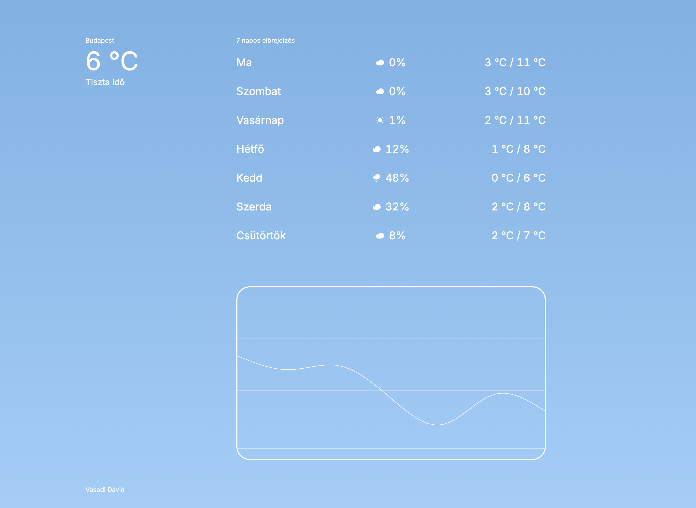

# Weather Forecast React — Medicover



**Live demo / Élő demó:** [davidvasadi.github.io/medicover](https://davidvasadi.github.io/medicover/)

[English](#english) · [Magyar](#magyar)

## English

You pick a city, and it shows the current weather, a 7-day forecast and a chart of the daily highs. The data comes from [Open-Meteo](https://open-meteo.com/), no API key needed.

### Run it

You'll need Node 20.19 or newer.

```bash
npm install
npm run dev
```

Then open http://localhost:5173.

### Stack

- **React + TypeScript**, Vite
- **TanStack Query** – API calls
- **Radix** – modal
- **Recharts** – chart
- **CSS Modules** – styles; the colors and font sizes from the Figma file live in `src/styles/variables.css`

### Notes

- Search modal for picking a city
- On the first visit the modal only closes once a city is picked
- The chosen city is saved in the browser
- Hover the chart to see each day's weather

## Magyar

# Időjárás-előrejelzés — React — Medicover

Kiválasztasz egy várost, és megmutatja az aktuális időjárást, a 7 napos előrejelzést és egy grafikont a napi csúcshőmérsékletekről. Az adatok az [Open-Meteo](https://open-meteo.com/)-tól jönnek, API-kulcs nem kell hozzá.

### Indítás

Node 20.19 vagy újabb kell hozzá.

```bash
npm install
npm run dev
```

Utána nyisd meg: http://localhost:5173.

### Stack

- **React + TypeScript**, Vite
- **TanStack Query** – API-hívások
- **Radix** – modal
- **Recharts** – grafikon
- **CSS Modules** – stílusok; a Figmából átvett színek és betűméretek a `src/styles/variables.css`-ben

### Megjegyzések

- Kereső ablak a városválasztáshoz
- Első megnyitáskor csak városválasztás után zárható be a modal
- A kiválasztott várost megjegyzi a böngésző
- A grafikonra mutatva látszik a nap időjárása

---

**Live demo / Élő demó:** [davidvasadi.github.io/medicover](https://davidvasadi.github.io/medicover/)

Vasadi Dávid
